# Summary

> [!WARNING]
> This write-up is an active work in progress. Some benchmarks are changing as I continue to optimise the engine and game. The write-up will be updated as I make progress. This is the public write-up for a private repository, so some of the content is intentionally vague or incomplete. If you have questions, please reach out to me directly.

[Link to the Game](https://snibble.gg)

> [!NOTE]
> Snibble started its life as a multiplyer word game combining Snake, Scrabble, and adversarial stealing mechanics.
>
> Over time, it has evolved into a game-engine and simulator.

|                                                     |                                                   |
| --------------------------------------------------- | ------------------------------------------------- |
| Collect a Letter                                    | Form a Word                                       |
| 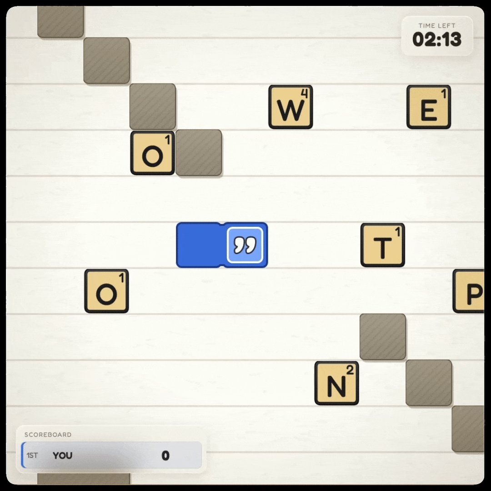 | 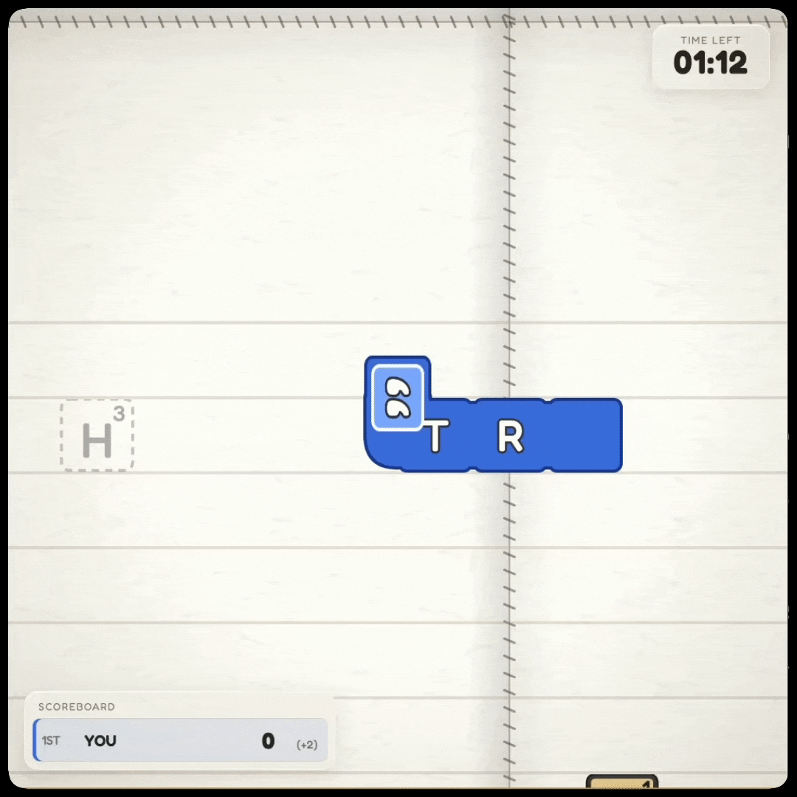         |
| Submit a Word                                       | Steal a Word                                      |
| 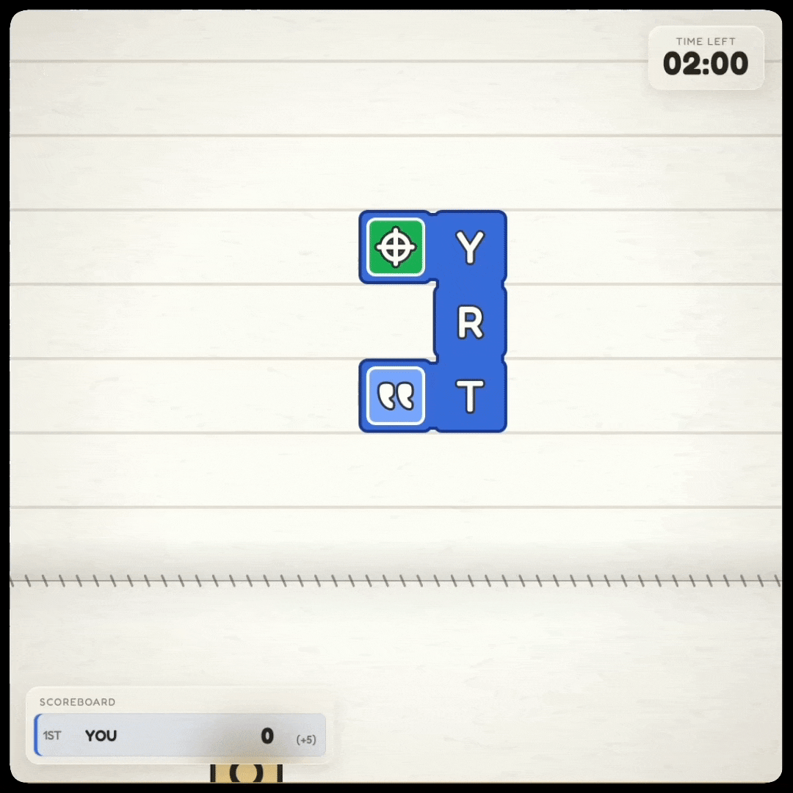       | 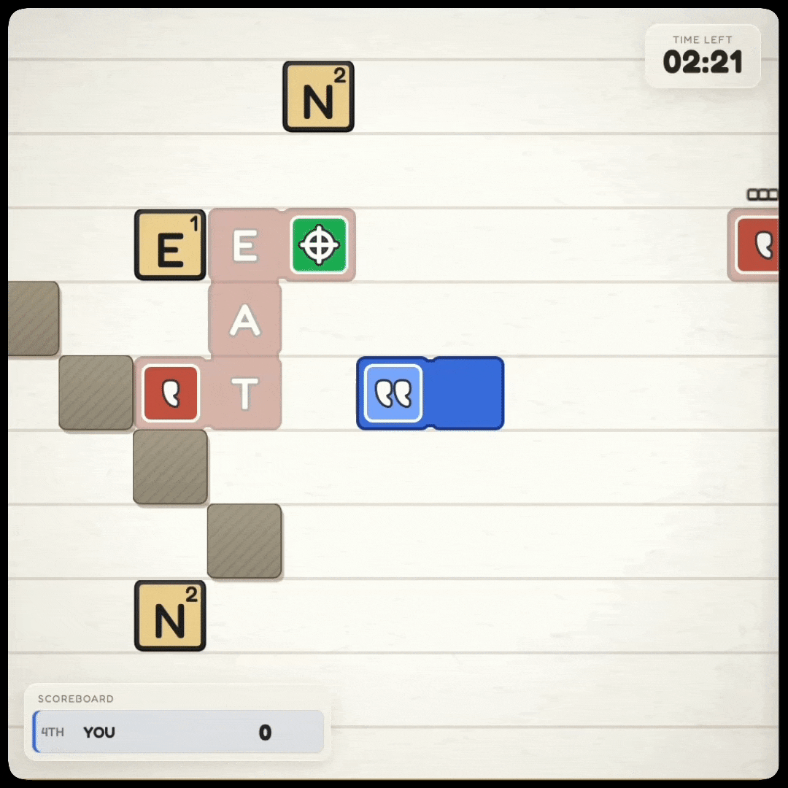 |

### The engine features:

- Headless simulation
- Discrete movement and actions, yet continuous fluid rendering and animation
- Exact game replays with a scrubbable timeline (like a video player)
- Tiny QR-encodable replays
- Procuedral level generation (walls) and sound generation
- Configurable bot "genes" for bot behaviour, with imperfect information and perception levels
- A custom binary wire protocol for multiplayer games and replay compression
- An infinite toroidal board with zones and flow fields
- Fully separated logic and rendering

---

# Architecture

## Procedural Wall Generation

Walls are generated based on the seed and a custom shape grammar of 8x8 shape primitives. The shape primitives can be scaled up to different powers of 2, allowing for a wide variety of wall configurations.

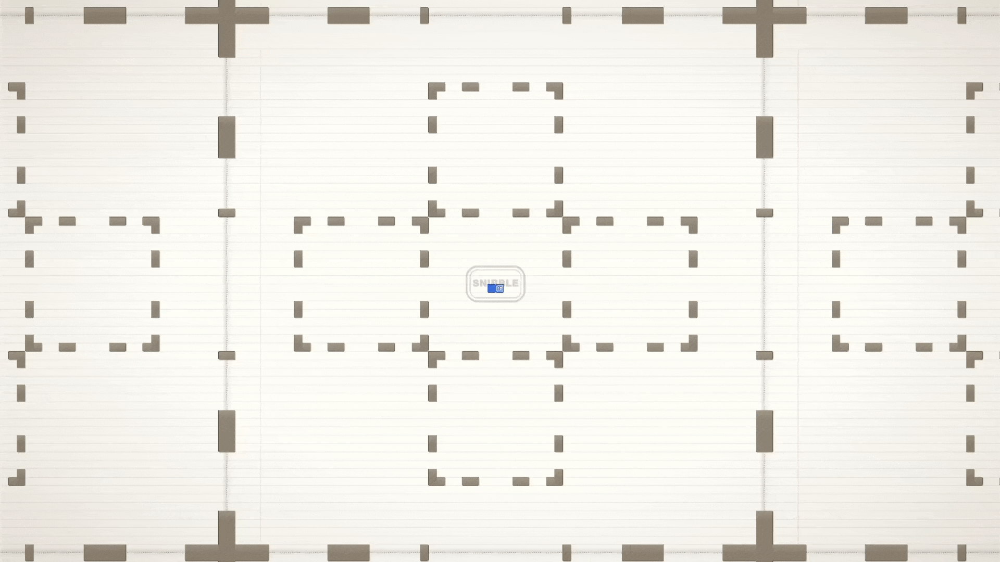

### Wall Shape Primitives

Each shape primitive is an 8x8 "grid" of wall segments and "nodes". How it works is 2x8-byte masks that get combined

- Mask 1: Define a 8x8 shape primtive of nodes (think of them as line end-caps)
- Mask 2:Define a second 8x8 shape primitive of walls (think of them as line segments)
- Each bit in the mask is a boolean value, where 1 = wall/node and 0 = empty space. The two masks are combined to form a single 8x8 shape primitive.

| Wall Primitive Diamond Example                              | Zoomed out board with Nodes coloured in                    |
| ----------------------------------------------------------- | ---------------------------------------------------------- |
| 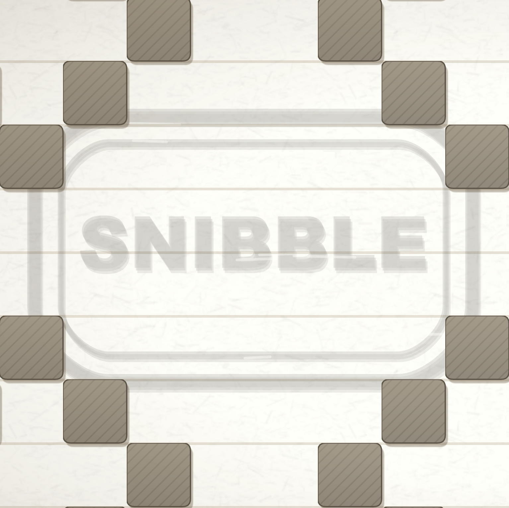 | 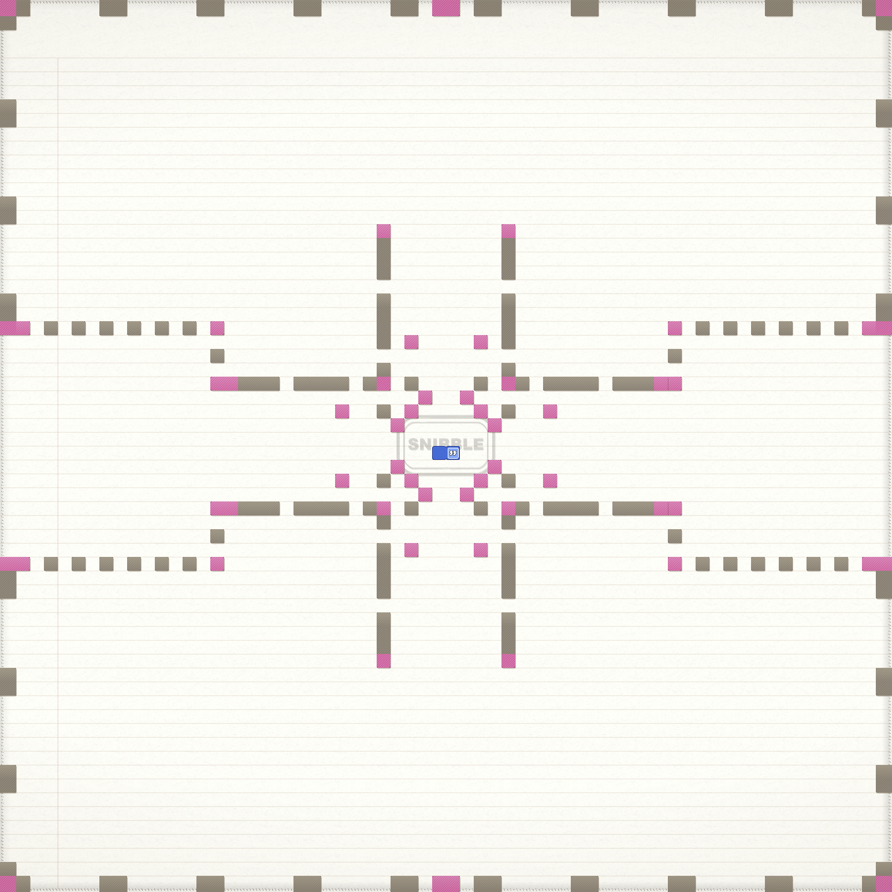 |

The node-wall stroke algorithm is a simple custom algorithm that draws a line between two nodes via line of sight, and then fills in the line with wall segments. The algorithm is designed to be fast and efficient, and it can handle a wide variety of wall configurations. In the above images, the nodes are pink, the walls are black, and the empty space is white. The walls are generated procedurally based on the seed, and they can be scaled up to different powers of 2. Walls can be connected via a solid or dotted "stroke" which is seed derived.

## Bot "Gene" System

Bots are driven by "genes", compact byte-encoded behavioural parameters that is used to make decisions. Each bot makes decisions by scoring candidate options and taking the highest-utility one. In previous gifs you can see bots hunting (!), thinking (...), or moving - if you look closely.

### Gene Variants

A gene belongs to one of seven categories, each of which can be tuned to a value between 0 and 255:

- `wordAmbition` — commit to short/fast words vs hold out for long, high-value ones
- `wordDiscipline` — strict valid-word play vs eats anything (garbage words, board chaos)
- `wordSense` — sticks to simple/common words (BOAT, CAT) vs form rare, obscure words (TSADES, QI)
- `aggression` — passive collector vs hunts other players tails
- `perception` — stops frequently to "think" and forgets board information vs stops infrequently and retains board information (my favourite gene - see note below)
- `caution` — reckless vs danger-averse
- `impulsiveness` — hoards letters and barely ejects them vs ejects them freely to escape or hunt or form a different word

### Perception Gene, or, Imperfect Information

> [!NOTE]
> Bots are not oracles, they don't see the whole board. The board is segmented into zones, and a bot can only see its current zone and its 8 adjacent neighbouring zones.
>
> Just like how humans have imperfect information and need to stop to "scan" the board, bots also have imperfect information and need to stop to "scan" the board. The perception gene controls how often a bot stops to scan, and how long it remembers what it saw.

| Imperfect Humans                              | Imperfect Bots                               |
| --------------------------------------------- | -------------------------------------------- |
| 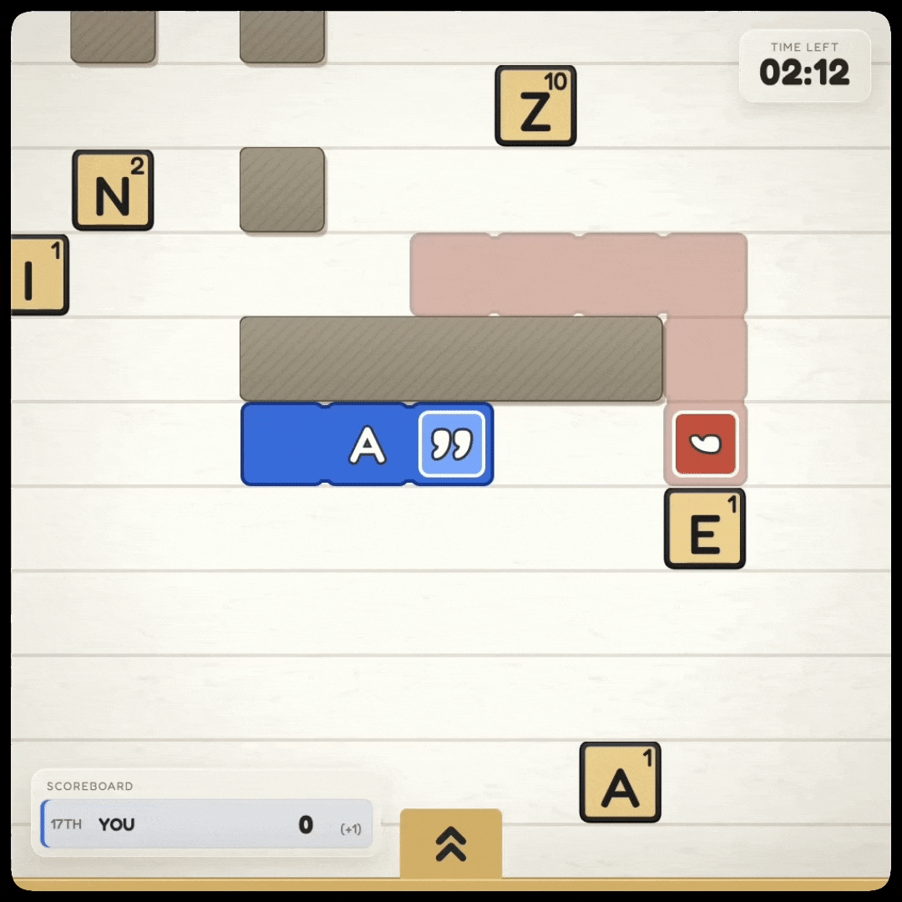 | 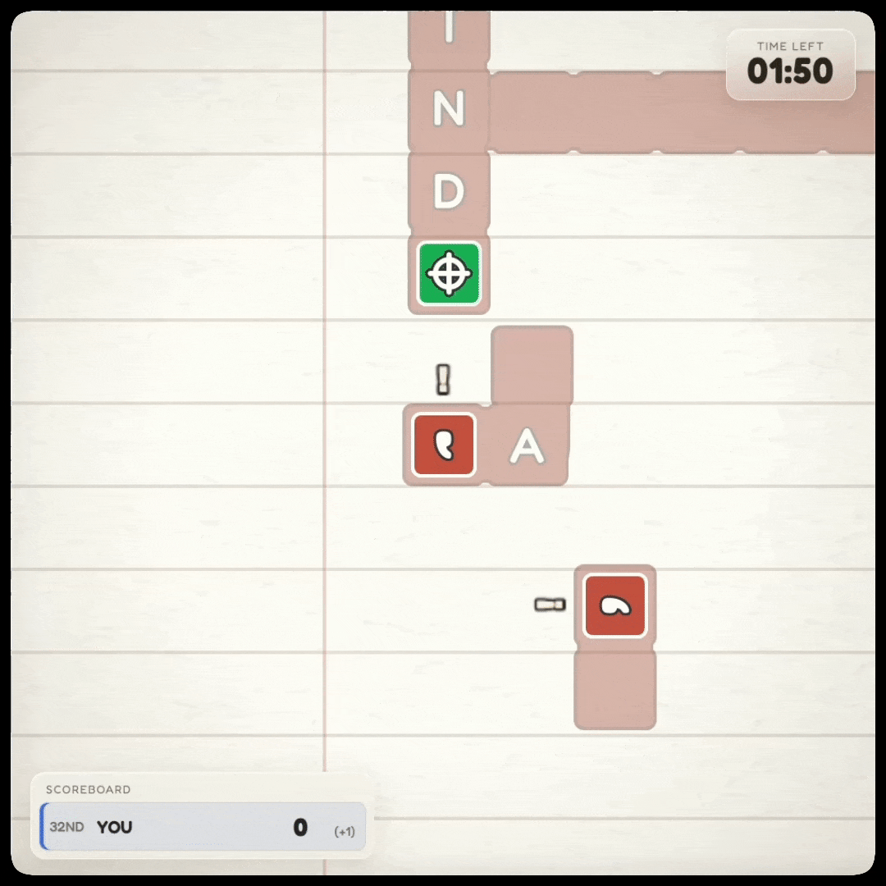 |

Zones have bitmasks over them which "hide" information from bots. So as bots play the game, they have imperfect information - just like a human. And just like a human, if they pause movement to stop and "scan" the board, the information is revelaed to them. But also just like a human, they forget what they saw after a while. The perception gene controls how often a bot stops to scan, and how long it remembers what it saw.

Why did I implement this? Becuase the game carries heavy processing overhead for humans, I first decided to implement non-continuous movement and actions so players can pause and think - unlike most snake games. Then I realised through playtesting that bots had perfect information so didn't have any need to pause, which caused an asymmetry in the game. I also did not want to introduce random pauses for bot movement, I wanted a more elegant solution akin to what the human player experiences. So partial information masking was the obvious solution given that the game was already segmented into power-of-2 zones.

## QR Code Replays

> [!NOTE]
> Here is the URL to the exact replay from the gif below: [https://snibble.gg/r/eJxjYGY0VT_BwMIwkVFZQIGPja3x6YM5zClfHRig4FUCAwsDA9NCBgZWRwYG9kIGBs6FDCICKgICCoIKAsogUqGBQUBA0KTFvE1dRUnISKlRUkxIUdSojVFYQVBBRMO4RaRFoElAwUlEQUHQ0VFIUMBByEFFqQUATK4Vgw](https://snibble.gg/r/eJxjYGY0VT_BwMIwkVFZQIGPja3x6YM5zClfHRig4FUCAwsDA9NCBgZWRwYG9kIGBs6FDCICKgICCoIKAsogUqGBQUBA0KTFvE1dRUnISKlRUkxIUdSojVFYQVBBRMO4RaRFoElAwUlEQUHQ0VFIUMBByEFFqQUATK4Vgw)

| Replay with camera subject switching | Scan this QR code to watch the EXACT replay from the gif                                        |
| ------------------------------------ | ----------------------------------------------------------------------------------------------- |
| 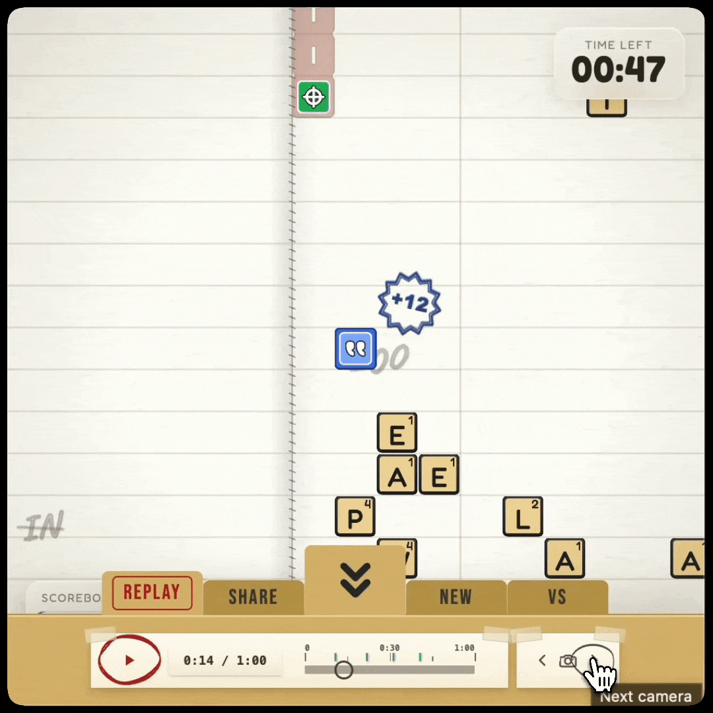     | 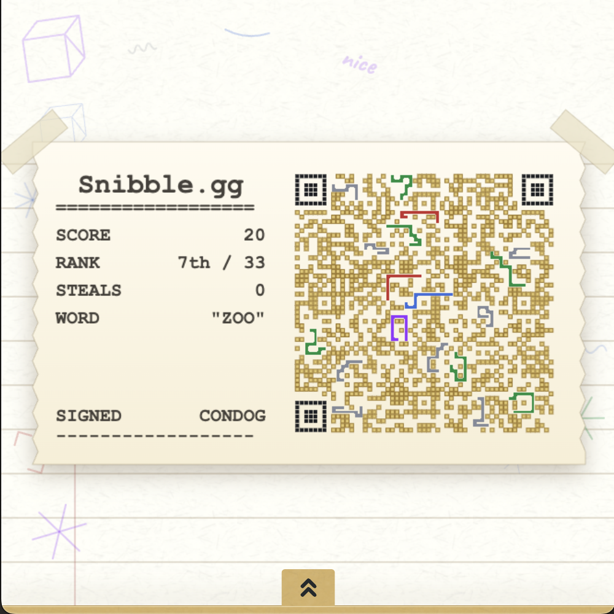 |

Every single played game can be replayed, and the replays are so tiny that they fit in a QR code. There is no server, no database, no url-shortener. This is the entire game state required to replay the exact game. The replay can be watched and scrubbed like a video, and the camera can be dynamically changed to follow any player. You can even play against your own "ghost" from a previous game.

And just for fun, I made the QR code look like an actual live game of Snibble with letter tiles and snakes.

## Compression Story and Custom Event Protocol

Player actions are a 1 byte event - the only actions a player can take are to stay still, or move in a cardinal direction (up, down, left, right) or to eject a letter. Behind the scenes actions are discrete step-based events tied to the grid structure positionally, even though visually the game appears to be continuous and movement is fluid between grid cells.

What is a player event-byte made of exactly?

- 1 bit encodes whether the player is paused or not
- 1 bit encodes whether the player is ejecting a letter or not
- 2 bits encode the turn (forward, left, right, reverse) relative to the way the snake is already facing \*\*
- And the remaining 4 bits encode the "tick-delta" since the last event \*

\* The major compression insight here was that the engine timestep / resolution is not 1-tick, it is actually 16-ticks. So each state of the tick-delta represents 16-ticks

\*\* The second insight was to store turns relative to the snake instead of as absolute directions. A left turn is the same byte no matter which way the snake is facing, so the stream repeats itself far more often, and repetition compresses well.

### The Exact Byte Layout

A replay is a 31 byte header, then a few optional sections, then 1 byte per event until the payload runs out. All multi-byte numbers are big-endian.

| Bytes | Field                 | Notes                                                                      |
| ----- | --------------------- | -------------------------------------------------------------------------- |
| 0-1   | Replay format version |                                                                            |
| 2-5   | Seed                  | The walls, letters and bots are all derived from this                      |
| 6-7   | Game version          |                                                                            |
| 8     | Game mode             |                                                                            |
| 9     | Flags                 | 8 bits, see below                                                          |
| 10-12 | Player start          | 2 bits direction, 9 bits x, 9 bits y, 4 bits spare                         |
| 13    | Bot count             |                                                                            |
| 14    | Collector bot count   | How many of those bots are the collector type                              |
| 15    | Board width           | Stored as the power of 2, so `06` means 64                                 |
| 16    | Board height          | Same again                                                                 |
| 17-20 | Dictionary hash       | So a replay can tell if the word list has changed underneath it            |
| 21-30 | Player name           | 4 bits spare, 4 bits length, then up to 12 letters at 6 bits each (A = 1)  |

Bytes 0 to 7 are frozen. They mean the same thing in every version of the format, forever, so any build of the game can read enough of any replay (older or newer than itself) to send it to the right version of the game.

The flags say which optional sections come next. They are always in this order:

| Flag bit | Meaning                     | Section that follows                               |
| -------- | --------------------------- | -------------------------------------------------- |
| 4        | Custom timer                | 4 bytes, the game length in milliseconds           |
| 3        | Input-driven participants   | 1 byte count, then 1 byte per participant          |
| 2        | Custom bot genes            | 2 byte length, then that many bytes of gene config |
| 1        | Player is an LLM            | 2 byte count, then 1 intent byte per event         |
| 7        | Player submitted words      | 2 byte count, then a 4 byte tick per submit        |
| 0        | Bots enabled                | Nothing                                            |
| 5        | Steals locked at the start  | Nothing (this is the tutorial)                     |
| 6        | Plan mode                   | Nothing                                            |

Everything after that is events, 1 byte each:

```
  bit    7       6      5 4     3 2 1 0
      pause | eject | turn  |  delta
```

- `turn` is `00` forward, `01` left, `10` right, `11` reverse
- `delta` is how many 16-tick steps have passed since the previous event, minus one. So `0000` means the very next step, and `1111` means 16 steps later
- If nothing at all happens for more than 16 steps, a filler byte (`0F` while moving, `8F` while paused) says "16 steps went by and nothing changed"

The snake always starts paused and facing its start direction, so the first event is usually "go".

The whole thing is then deflated, base64url encoded, and stuck on the end of `https://snibble.gg/r/`. That is the replay.

### One Replay, Decoded

Here is the replay from the gif and QR code above, taken apart. The payload in the URL is 166 characters. Base64 decode it and you get 124 bytes, inflate those and you get these 123 bytes:

```
00 03                            replay format version 3
01 35 27 c8                      seed 20260808 (the daily seed for 8 August 2026)
00 04                            game version 4
00                               game mode (classic)
91                               flags 1001 0001: bots on, custom timer, has submits
01 23 10                         start: facing right at x=9, y=49
20                               32 bots
0e                               14 of them collectors
06 06                            board is 2^6 by 2^6, so 64x64
81 e5 e0 9c                      dictionary hash
03 64 f5 40 00 00 00 00 00 00    name: 3 letters, 25 15 21, so "YOU"

00 00 ea 60                      timer: 60,000ms, a 1 minute game
00 04                            4 submits, at ticks:
00 00 02 a1                        673  (11.2s)
00 00 05 41                        1345 (22.4s)
00 00 07 71                        1905 (31.8s)
00 00 09 a1                        2465 (41.1s)

00 14 10 24 10 10 20 11 20 10    70 events, 1 byte each
23 10 20 11 20 20 80 00 10 10
11 34 84 37 86 27 24 22 12 32
22 81 19 16 12 21 15 32 86 01
13 20 11 20 14 28 33 84 14 84
10 82 10 20 42 14 20 20 11 41
41 12 11 10 40 12 40 24 22 84
```

31 bytes of header, 4 for the timer, 18 for the submits, and 70 for the events. And here are some of those events decoded:

| Byte | Bits          | Step | What happened                         |
| ---- | ------------- | ---- | ------------------------------------- |
| `00` | `0 0 00 0000` | 0    | Go (forward, so heading right)        |
| `14` | `0 0 01 0100` | 5    | 5 steps later, turn left. Heading up  |
| `10` | `0 0 01 0000` | 6    | 1 step later, turn left. Heading left |
| `24` | `0 0 10 0100` | 11   | 5 steps later, turn right. Heading up |
| ...  |               |      |                                       |
| `80` | `1 0 00 0000` | 29   | Stop and think                        |
| `00` | `0 0 00 0000` | 30   | Go again                              |
| ...  |               |      |                                       |
| `42` | `0 1 00 0010` | 176  | Eject a letter and keep going         |
| ...  |               |      |                                       |
| `84` | `1 0 00 0100` | 213  | Stop. The last input of the game      |

A step is 16 ticks at 60 ticks a second, so step 213 is 56.8 seconds into a 60 second game. In that minute I made 70 inputs, stopped to think 9 times, ejected 5 letters and submitted 4 words. That is everything needed to rebuild the exact game, 32 bots included.

Notice that deflate actually made this replay a byte bigger (124 bytes vs 123). A 1 minute game is too short to have any patterns worth compressing. It earns its keep on longer games.

### Size by Game Length

> [!NOTE]
> These numbers come from running real 32 bot games on 3 seeds, and encoding every bot's inputs as if that bot was the player, using the exact same code that builds the share URL. That is 96 replays per game length.
>
> "Typical" is the median bot. "Busiest" is the biggest replay of the 96.

| Game length | Inputs (typical) | Raw bytes (typical) | URL characters (typical) | URL characters (busiest) | Fits in a QR code?      |
| ----------- | ---------------- | ------------------- | ------------------------ | ------------------------ | ----------------------- |
| 1 min       | 43               | 84                  | 114                      | 163                      | Yes                     |
| 5 min       | 207              | 264                 | 296                      | 423                      | Yes                     |
| 15 min      | 601              | 677                 | 659                      | 999                      | Yes                     |
| 30 min      | 1,159            | 1,304               | 1,143                    | 1,804                    | Yes                     |
| 60 min      | 1,724            | 2,090               | 1,614                    | 3,334                    | Typical yes, busiest no |

A QR code holds 2,953 characters at most. So every game up to 30 minutes fits with room to spare. An hour is where it runs out, the typical bot still fits but the busiest ones do not.

The rule of thumb is 1 byte per input and 4 bytes per submitted word, on top of a fixed 31 byte header. Compression does nothing for short games and takes roughly a third off the long ones.

Two things to keep in mind:

- The number of bots does not change the size at all. Bots are deterministic, so they are re-simulated from the seed. Only the player's inputs are stored
- Humans are twitchier than bots. My own 1 minute game above came out at 166 characters, which is more than the busiest bot managed in a minute. So for a real player, the "busiest" column is the realistic one

## Performance and Stress Testing

> [!NOTE]
> All benchmarks were run on a 2021 Macbook Pro 16GB RAM.
>
> The game was run in a chrome browser with measurements using the chrome performance profiler.

| 2048 enemies in play (constant 60 FPS) | All space occupied by letters (constant 60fps) |
| -------------------------------------- | ---------------------------------------------- |
| 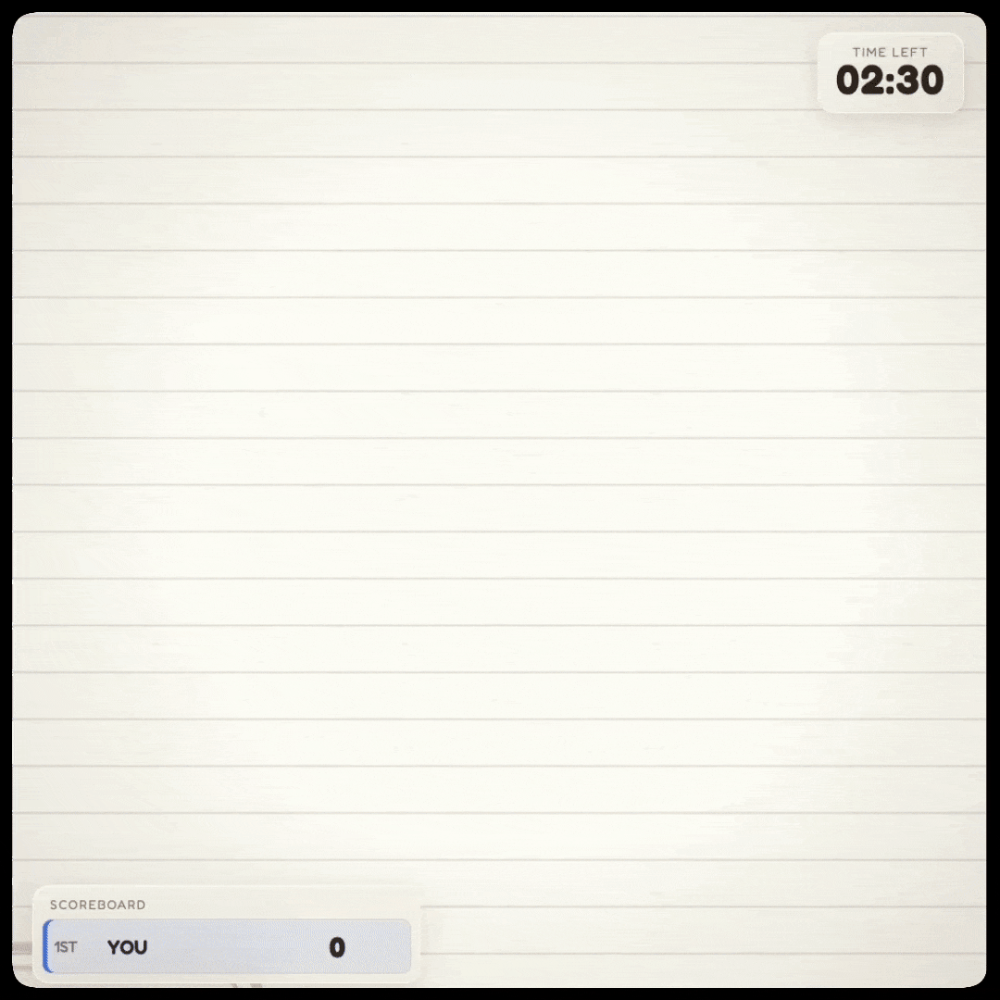 | 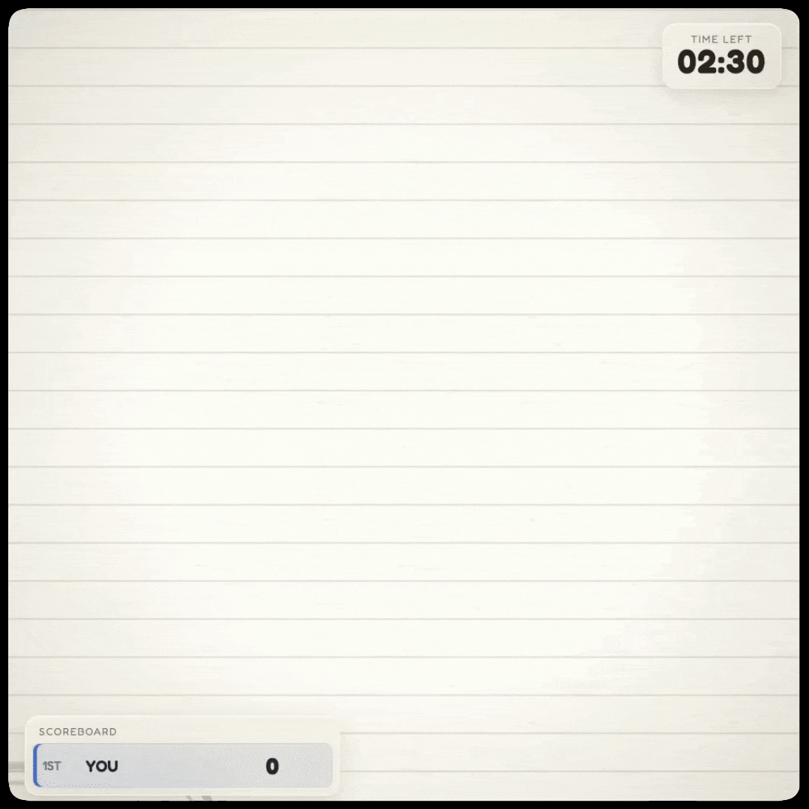    |

---

# Challenges

## Multiplayer Replays and the Rift Experiment (Scrapped)

Single player replays are tiny because the bots are free. Real multiplayer breaks that. Every human on a shared board changes it for everybody else, so an exact replay needs every player's inputs, not just yours. In my simulations a 30 minute game with 16 players came out at 14,633 bytes compressed, and with 64 players it was 51,163 bytes. A QR code tops out at 2,953 characters.

I tried a pile of multiplayer-specific codecs, and they all came out bigger than just storing each player's stream one after the other. So I stopped trying to compress my way out of it and changed the game instead.

### The Idea

What if multiplayer is not conventional multiplayer? The game already lets you play against your own ghost. So what if multiplayer is just playing against the ghosts of other players?

- Every player plays on their own private board, all generated from the same seed
- You can see every other player, but they are ghosts. They are drawn as faint paper shadows and they cannot touch your board or take your letters
- So your replay is just you playing by yourself, and I had already smashed compression for a single player

Then the fun part, the rift. A rift is a portal between two players' boards, and it is your own word that opens it:

- When your word turns green, your tail emits a 17x17 field around itself
- Any snake whose head is inside that field materialises on your board
- Once your tail is armed (#), anyone inside the field can steal it
- The rift closes when you submit the word or it gets stolen

It is like a location based Dark Souls invasion. And the replay only needs your own inputs, plus small slices of a rival's inputs for the moments they were inside your rift.

### The Measurements

Bots standing in for humans, 30 minute games, with the board scaled up as the player count grows:

| Players | Every player's inputs (bytes) | Rift replay (bytes) | Saving | URL characters | Fits in a QR code? |
| ------- | ----------------------------- | ------------------- | ------ | -------------- | ------------------ |
| 16      | 14,633                        | 1,191               | 92%    | 1,588          | Yes                |
| 64      | 51,163                        | 1,221               | 98%    | 1,628          | Yes                |
| 128     | 119,522                       | 1,385               | 99%    | 1,847          | Yes                |
| 256     | 234,199                       | 1,503               | 99%    | 2,004          | Yes                |

A 256 player, 30 minute game in a QR code. The replay barely grows with the player count, because what matters is who is near your tail, not how many people are in the lobby.

### Why I Killed It

The numbers were ridiculous. The game was not.

I built it for real at the end of June, played it, and about a week later I ripped it out and put everyone back on one shared board. It just wasn't fun to play this way. Other players are ghosts right up until a word goes green, so most of the time you are playing alone next to people instead of against them.

So multiplayer is back on a shared board, and multiplayer replays are back to being too big for a QR code.

## Word Forming Ability and Hand-Holding

| No hand-holding (harder)                 | Hand-holding (easier)                      |
| ---------------------------------------- | ------------------------------------------ |
| 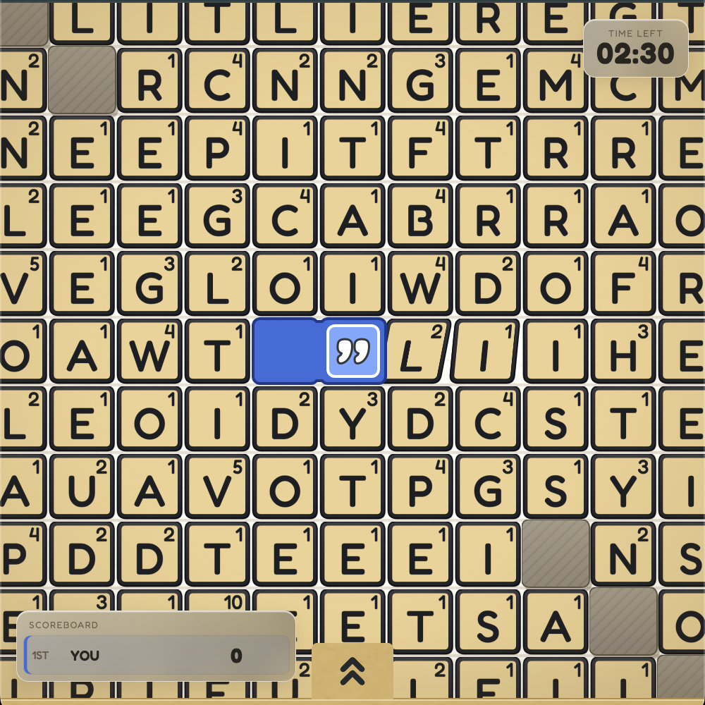 | 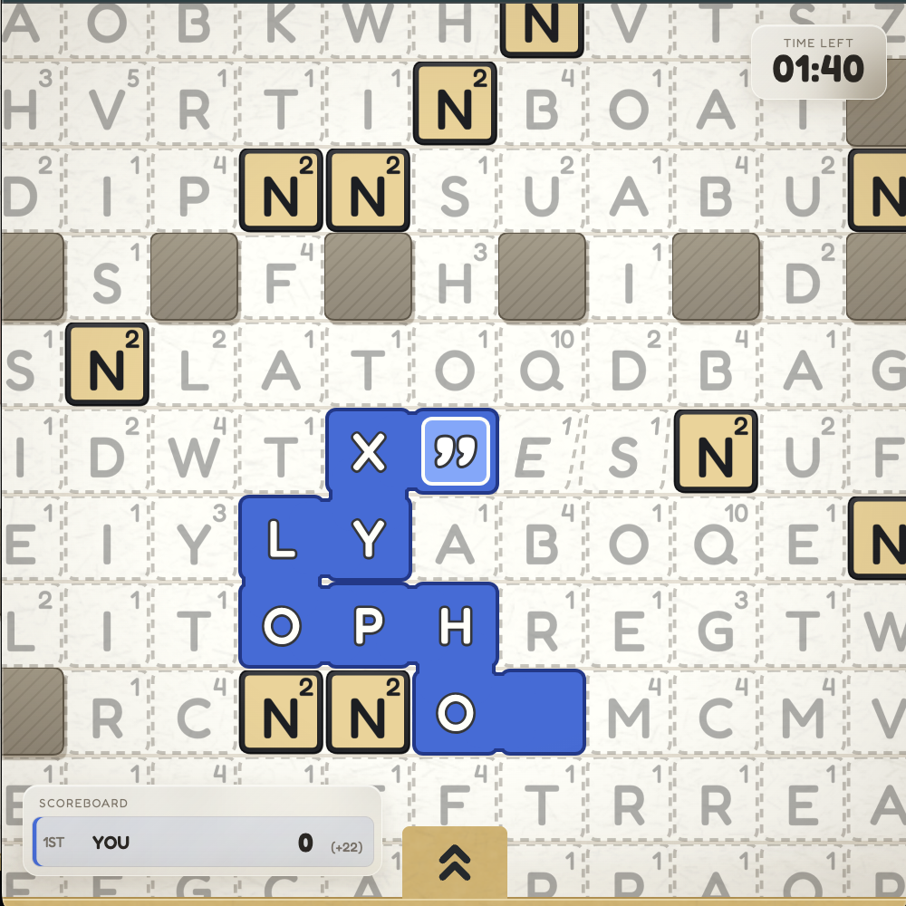 |
